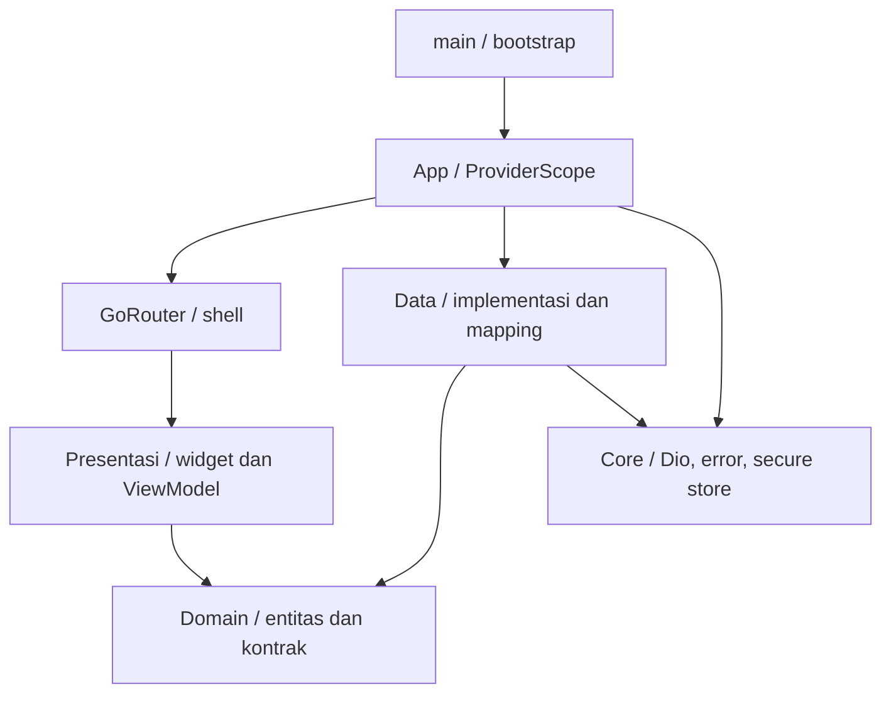

# Arsitektur

Aplikasi adalah modular monolith Flutter. Modul memakai Feature-first Clean Architecture dan MVVM pragmatis. Widget merender state dan meneruskan aksi. Controller mengelola state dan berinteraksi dengan kontrak domain. Implementasi data menangani penyimpanan dan transformasi. Composition root di `app/` menyatukan infrastruktur dan fitur.

Domain tidak mengimpor Flutter, Dio, provider, atau data. `core/` bebas dari fitur. Widget tidak memanggil API atau data source. Gunakan use case ketika ada aturan bermakna atau koordinasi beberapa operasi. Lihat [folder](FOLDER_STRUCTURE.md) dan [ADR](../decisions/).
