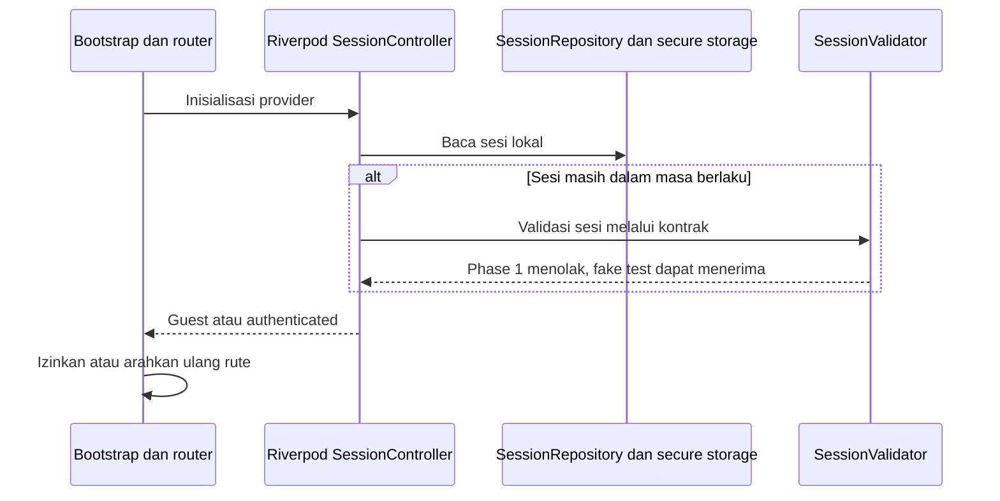

# Alur data

`main.dart` memanggil `bootstrap.dart` untuk parsing environment dan memasang `ProviderScope`. Kesalahan format memunculkan pesan lokal tanpa memulai router. Router berlangganan state sesi dan mengambil keputusan saat rute atau sesi berubah. Kedaluwarsa memicu pencabutan akses melalui timer dan diperiksa lagi saat app resume, saat guard berjalan, serta sebelum injeksi header.

Alur fitur API mendatang adalah View → ViewModel → repository domain → implementasi data → Dio. Repository mengubah DTO menjadi entitas, dan memetakan `DioException` ke `AppFailure`. ViewModel menetapkan state UI, sedangkan widget mengubah kategori error menjadi teks dari ARB. Fitur menentukan kapan retry sesuai operasi.
