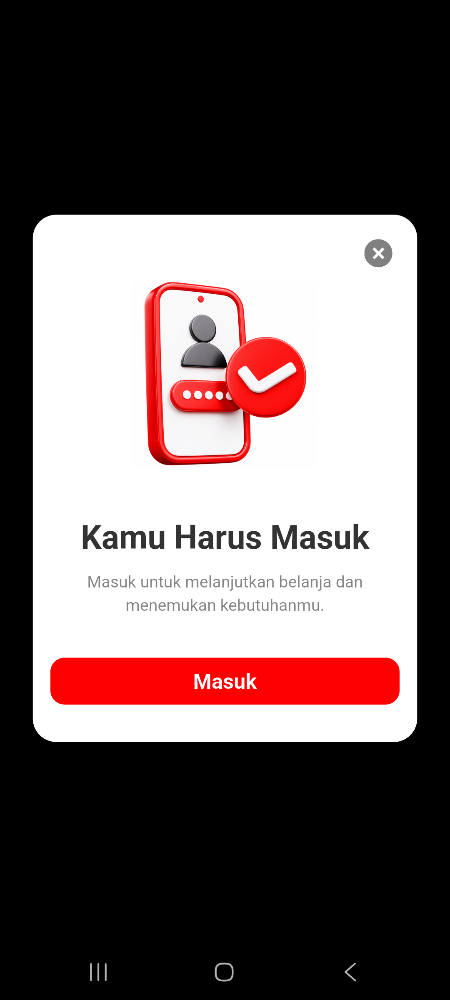
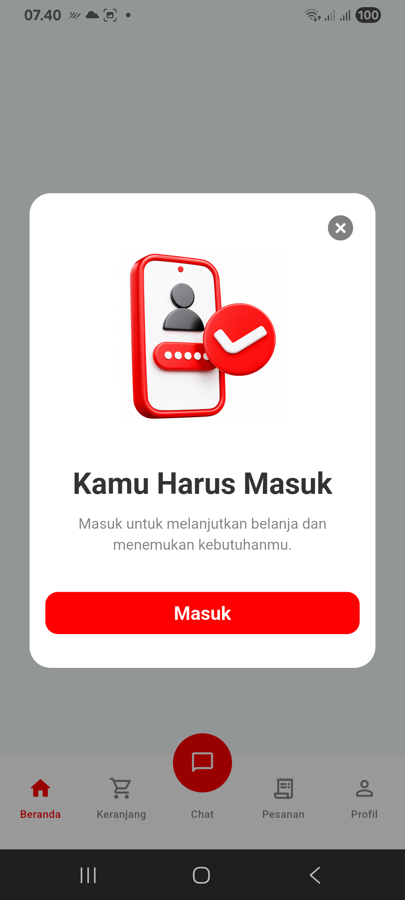

# Verifikasi Dialog Autentikasi Wajib

## Diagnosis

Sebelumnya, memilih menu terlindungi mengarahkan pengguna tamu ke route root `/login-required`. Route itu berada di luar `ShellRoute`. Walaupun halaman route dibuat transparan, GoRouter mengganti route shell yang sedang aktif sehingga konten di belakang dialog—termasuk bottom navigation—sudah tidak ada. Area transparan kemudian memperlihatkan latar hitam. Screenshot sebelum perubahan mengonfirmasi kondisi ini.

## Perbaikan

- Pemilihan menu terlindungi oleh tamu sekarang membuka `LoginRequiredDialog` yang sudah ada melalui `showDialog` pada root navigator. Shell dan halaman aktif tidak diganti.
- Barrier menggunakan `Colors.black.withValues(alpha: 0.4)`. Dialog mempertahankan container putih dan seluruh ilustrasi, typography, radius, spacing, serta tombol yang sudah ada.
- Close, tap pada barrier, dan tombol Android Back hanya menutup dialog. Tombol Masuk menutup dialog lalu membuka route login yang ada dengan tujuan terlindungi yang valid.
- Navigator aktif mencegah dialog ganda. Route terlindungi tetap dijaga; akses langsung/deep link pengguna tamu diarahkan kembali ke Beranda, bukan ke konten terlindungi atau route dialog layar penuh.
- `MainShell` tetap menjadi pemilik header opsional dan bottom navigation. Screenshot perangkat ini menunjukkan halaman Beranda placeholder dan navbar di belakang overlay. Header saat ini tidak dipasang pada placeholder Beranda; tes shell terpisah memastikan header tetap terpasang bila tersedia.

## Bukti Screenshot

Keduanya diambil dari SM A057F pada resolusi 1080 × 2400. Sebelum: latar hitam di sekitar dialog. Sesudah: halaman dan navbar terlihat melalui overlay gelap.

## Hasil Verifikasi

| Pemeriksaan | Hasil |
|---|---|
| `flutter analyze` | Lulus, tidak ada issue. |
| `flutter test --concurrency=1 --reporter expanded` | Lulus, 41 tes unit/widget. Cakupan termasuk Cart, Pesanan, Profil, Notifikasi, alpha barrier, keberadaan shell di belakang dialog, tombol tutup/masuk, back, dan guard rute langsung. |
| SM A057F, build dan startup flavor `dev` | Lulus; APK terpasang dan menampilkan aplikasi. |
| SM A057F, barrier serta halaman/nav di belakang dialog | Lulus melalui screenshot sesudah perbaikan. |
| SM A057F, Android Back dan tombol Close | Lulus; keduanya mengembalikan pengguna ke halaman Beranda. |
| SM A057F, tombol Masuk | Lulus; membuka halaman login yang ada. |
| Integration test di SM A057F | Belum lulus. Percobaan pertama gagal pada assertion judul dialog setelah tap Keranjang. Percobaan ulang dengan jeda pemulihan sesi terhenti sebelum tes dimulai karena `:app:compressDevDebugAssets` gagal dengan `No space left on device`. Penyebab assertion pertama belum terisolasi; alur yang sama berhasil saat diuji manual. |
| `git diff --check` | Lulus. |

Pengujian visual ini memverifikasi perilaku modal, bukan klaim pixel-perfect terhadap Figma. Detail halaman dan header di luar dialog bukan bagian dari perubahan ini.
